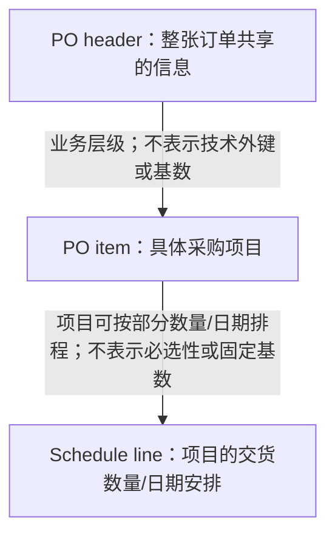

# MM-10｜采购与库存数据模型：从业务对象到待核技术关系

> 状态：`drafting`｜M4 批次 A｜目标版本：SAP S/4HANA 2021 On-Premise。本文目前只解释目标版来源能够支持的采购订单业务层级，以及为什么业务对象关系不能直接当作数据库结构。PR、采购订单历史、物料凭证之间的完整技术映射，字段键、基数、客户端/组织边界、物理表与兼容视图、发布 API 和权限尚未形成足够的固定版直接证据；本文不将未核部分补成确定模型。

## 先区分四层“模型”

学习 SAP 数据模型时，“同一流程里会出现这些单据”不等于“已经知道它们在数据库里怎样关联”。先区分四层：

| 层次 | 回答的问题 | 本文目前能说明什么 |
| --- | --- | --- |
| 业务对象层 | 采购人员分别处理什么业务对象？ | 采购申请（Purchase Requisition，PR）表达内部需求；采购订单（Purchase Order，PO）是面向外部供应商的材料/服务采购请求。PR 后续进入 PO 是业务流程能力，不等于已知技术字段映射。 |
| 界面呈现层 | 应用页面向用户展示哪些业务内容？ | 固定版 PR 应用说明可按 workflow 配置在 header/item 层查看审批详情。界面层级不等同数据库结构，也不证明某个客户账号有该页面权限。 |
| API 服务层 | 官方接口暴露哪些实体、键和操作？ | 当前未能用 S/4HANA 2021 On-Premise 直接 API 文档核实 PR/PO/历史/物料凭证的完整接口合同及 release 状态；不从页面或当前 API 文档推断。 |
| 物理存储层 | 实际落在哪些表/视图，如何用键连接？ | 当前资料不足以给出 PR、PO、订单历史和物料凭证的完整物理表/兼容视图、精确键、基数及读写行为。 |

这里的“键”指用于唯一识别记录或建立关联的一组技术字段；“基数”描述关系两侧可能出现多少个对象。Client（客户端）在 SAP 环境中是划分数据与配置范围的概念，不是用户端应用程序；本文只用它解释待核的数据边界，不据此断言它进入哪些 PR/PO 技术键。兼容视图是一个通用技术术语，通常指为特定既有访问方式提供兼容读取界面的数据库视图；具体对象、定义和读写限制须按目标版直接资料确认。API release 状态指接口是否被 SAP 作为正式发布合同提供；字段与版本状态仍需查对应官方资料。以上是术语释义，不是对 S/4HANA 2021 某张表、某个视图或某个 API 的确认。没有目标版直接来源时，不从屏幕、字段名称、相邻文章或其他版本猜出答案。

## 目标版来源直接支持的有限结构

### 采购订单：供应商采购单据的抬头、项目与交货排程

SAP S/4HANA 2021 On-Premise 固定版帮助中的 **Purchase Order** 页面，版本选择为 `2021 (Oct 2021)`，说明订单包含抬头信息和项目；抬头信息适用于整张订单，例如付款或交货条件。页面还说明项目可按部分数量和交货日期安排排程行（schedule line）。以下仅教这页支持的供应商采购业务层级，不覆盖 STO、中心采购及其他特定采购模式的完整结构。

| 对象层 | 可以直接教给学习者的内容 | 不可据此推出 |
| --- | --- | --- |
| PO header（抬头） | 一张采购订单共有的信息，例如付款或交货条件 | 抬头对应哪张物理表；所有字段的默认、继承或变更规则 |
| PO item（项目） | 订单中的具体采购项目 | 一张 PO 的项目数量上限、项目编号键，或所有字段的组织级别 |
| schedule line（排程行） | 固定版帮助以部分数量和日期说明项目的交货计划 | 排程行的物理表名、必选性、完整复合键、技术基数与所有项目类型的适用规则 |

可用下图记住**来源支持的 PO 业务层次**。箭头只表示页面说明的业务层级/包含关系，不表示 1:N 基数、必选参与、数据库外键或技术 JOIN；图也不包含 PR、订单历史、物料凭证的技术关联：

### 采购申请：屏幕显示层级不是存储模式

固定版 SAP Help “Create Purchase Requisition” 页面（2021 年 10 月版）提及，用户可以按 workflow 配置查看 PR header 或 item 层审批详情。它能支持“该应用展示了这两个审批详情层级”这一有限说法；它不是 PR 数据库结构说明，也没有给出 PR 项目的精确键、技术对象、API 合同或与 PO 项目的完整映射。页面描述的应用能力不等于你的用户已获授权、页面已启用或 workflow 已配置。

### PR 到 PO：已证实业务能力，不代表字段关联合同

S/4HANA 2021 Feature Scope Description（FSD）在 §2.12.4.2 “Requirements Processing” 与 §2.12.4.3 “Purchase Order Processing” 说明：采购申请可进入后续采购订单处理；可把多个 PR 合并到一个 PO；创建 PO 时可基于 PR 或其他参考。该文档版本 11.0（2026-07-22），Document History 标示为 SAP S/4HANA 2021 Support Package Stack 10（SPS10）。PDF 链接包含 `latest`，是动态链接，不能保证以后打开仍是同一快照；本篇只用其所列 S/4HANA 2021 SPS10 高层功能，不把它说成 2021.000 固定版帮助页。

因此，PR→PO 在本篇中是**来源明确列出的采购业务能力**；它不回答一条 PR 项目如何拆分/合并成订单项目、对应关系是否固定、数量/价格/组织字段如何传递，或哪种业务条件可触发自动创建。MM-04 保留了更多业务场景边界，见 [《采购申请与订单机制》](../02-functions/requisition-po.md)。

> 小例子：部门提出一项 100 件材料需求，采购人员按适用处理创建一张或多张供应商采购订单。S/4HANA 2021 SPS10 FSD 支持 PR 可以成为 PO 的后续来源，也列出多个 PR 可合并到一张 PO 的业务能力；这不表示题目中的 PR 项目如何映射到 PO 项目已被本文技术核实。

## 库存模型变化：知道有变化，不代表已经得到完整表图

SAP 官方《Simplification List for SAP S/4HANA 2021 – Initial Shipment, Feature Pack Stack 1 & 2》覆盖 2021 初版、FPS01 和 FPS02；§24.5（印刷页 478）将 **DATA MODEL IN INVENTORY MANAGEMENT (MM-IM)** 列为库存管理数据模型简化主题。它能作为“2021 库存模型有专门变化需要核对”的路标，但不能单独回答本篇所需的 PR/PO/历史/物料凭证实体全貌、精确字段键、每条关联的基数、兼容视图读写行为或 API 发布状态。该章节及覆盖范围仍不等于完整表图。

因此，本文不把经典 ERP 表名、网上常见连接字段、其他版本帮助或动态最新 API 页面直接带入 S/4HANA 2021 的目标模型。任何后续加入的表名或字段，都必须给出指向 S/4HANA 2021 On-Premise 的直接来源，并注明它证明的是数据库对象、兼容视图还是 API 实体。

## 尚未闭合的关系与验证边界

M3 对 MM-10 的准入标为“暂缓核心”。目前仍需逐项取得目标版直接证据：

| 待核对象/边界 | 尚未回答的问题 | 足以关闭该项的证据门槛 | 当前状态 |
| --- | --- | --- | --- |
| PR 对象 | header/item 的技术对象、字段、键和项目组织范围 | S/4HANA 2021 On-Premise 直接说明技术对象与相关字段/键的来源；只讲界面或 FSD 不足以关闭 | 未闭合 |
| PR→PO | 项目、数量与分配字段如何引用/拆分/合并，关系是否随采购类型变化 | 目标版技术文档直接说明实体关系、引用字段和基数；若只讲业务流程，仍不能画数据库连接 | 未闭合 |
| PO history→收货/发票/物料凭证 | 对象覆盖范围、精确键与关联基数 | 固定版数据模型或接口定义明确相关对象、键与关联；业务“后续过程”描述不足以关闭 | 未闭合 |
| MM-IM 存储 | S/4HANA 2021 物理表、兼容视图与视图定义/读写边界 | 对应 2021 文档需直接定义对象与适用版本，且区分物理存储和兼容访问方式 | 未闭合 |
| released API | 2021 On-Premise 可用接口、release 状态、版本、实体键、导航和限制 | SAP 2021 API 文档/官方发布状态须能核对；当前或 Cloud API 页面不能替代 | 未闭合 |
| Client（客户端）边界 | 该层是否参与这些实体的字段/唯一性/读取范围 | 目标版本技术模型或安全资料直接说明，不把通用 SAP 常识转成表键结论 | 未闭合 |
| 组织边界 | Company Code、Plant 等值在对象、字段和关联中的作用 | 固定版对象/字段资料直接支持；不能由业务组织关系推导数据库键 | 未闭合 |
| 权限与服务访问 | 哪种角色能查看应用、调用服务或读特定模型对象 | S/4HANA 2021 官方权限文档；若要判断学习者系统，另需该系统经授权的只读核对 | 未闭合 |

固定 2021 页面或 SAP 文档能够说明产品的一般功能，不等于已验证学习者所在系统的表结构、API 可用性、授权或实际数据。本文没有连接 SAP 系统，没有查看客户数据或验证角色权限。即使后续找到官方技术对象说明，业务组织字段、client 范围和授权对象仍要分别核证，不能互相替代。

## 只读学习练习

不需要登录 SAP。请用虚构数据回答，并把“来源支持”和“仍待证”分开写：

1. 一张 PO 同时有整张订单共用的信息、两个采购项目；其中一个项目按两个预计日期分批交货。哪些是 2021 固定版帮助直接支持的业务层级？
2. 部门提出的 PR 后来由采购人员转成 PO。当前资料能说明这是哪种业务关系？还能否说明 PR 与 PO 项目的技术键或一对一/多对一基数？
3. 某个收货案例材料列出了相关 PO 项目、物料凭证与 PO 历史信息，但未说明它们之间的映射。需要哪些固定版材料，才能确认关联字段、是否可有多条记录及适用条件？题干不预设对象数量或一对一关系。
4. 你在某篇博客中看到 `EKKO`、`EKPO` 或其它表字段名。还需要哪些版本与对象证据，才能将它写进 S/4HANA 2021 的数据模型笔记？

**参考思路：**第 1 题可按 PO header → PO item → schedule line 解释业务层级；其他题先保留问题，不按惯用表名或流程惯例补出关系。只要尚未找到固定版直接证据，答案就应写“当前资料无法确认”，并把待查对象、键、基数、版本和 API 状态列清楚。

## 来源与关联

- SAP Help：**Purchase Order**，SAP S/4HANA On-Premise `2021.000` 固定版：[页面链接](https://help.sap.com/docs/SAP_S4HANA_ON-PREMISE/f7fddfe4caca43dd967ac4c9ce6a70e4/3687c1536ca9b54ce10000000a174cb4.html?version=2021.000)。本文只采用该页的 header、item 与部分数量/日期排程业务层级。
- SAP Help：**Create Purchase Requisition**，Version `2021 (Oct 2021)`：[页面链接](https://help.sap.com/docs/SAP_S4HANA_ON-PREMISE/e296651f454c4284ade361292c633d69/dcb104de3cf949deb0b6d1d6e67167df.html?locale=en-US&state=PRODUCTION&version=2021.000)。本文只采用该应用对 PR header/item 层审批详情的描述。
- SAP S/4HANA 2021 Feature Scope Description，文档版本 `11.0`（2026-07-22），历史记录标示 SAP S/4HANA 2021 SPS10；§2.12.4.2–§2.12.4.3，印刷页 157–160：[官方 PDF 动态链接](https://help.sap.com/doc/e2048712f0ab45e791e6d15ba5e20c68/2021/en-US/FSD_OP2021_latest.pdf#page=157)。本文只采用其中“以 PR 为后续来源/合并多个 PR 到一个 PO”的高层能力，并披露该链接是动态 `latest`，不证明技术键、基数或转换算法。
- SAP，《Simplification List for SAP S/4HANA 2021 – Initial Shipment, Feature Pack Stack 1 & 2》，§24.5、印刷页 478：[官方 PDF](https://help.sap.com/doc/f2591a6901344c97a5e2029cc8f3703e/2021/en-US/SIMPL_OP2021.pdf#page=478)。
- M3 逐篇准入：[MM-10 分流](../../../plans/m3-item-readiness-triage-v0.3.md)；[逐篇范围与依赖](../../../plans/detail-logistics-v0.3.md)；[MM/QM 来源复核](../../../plans/review-evidence-mm-qm-m3.md)。
- 关联阅读：[MM-04 PR 与 PO 业务处理](../02-functions/requisition-po.md)、[MM-05 库存类型和货物移动](../02-functions/stock-movement.md)、[MM-06 收货和材料凭证边界](../02-functions/gr-returns-reversal.md)。这些链接帮助建立业务背景，不自动补足本篇技术模型证据。
